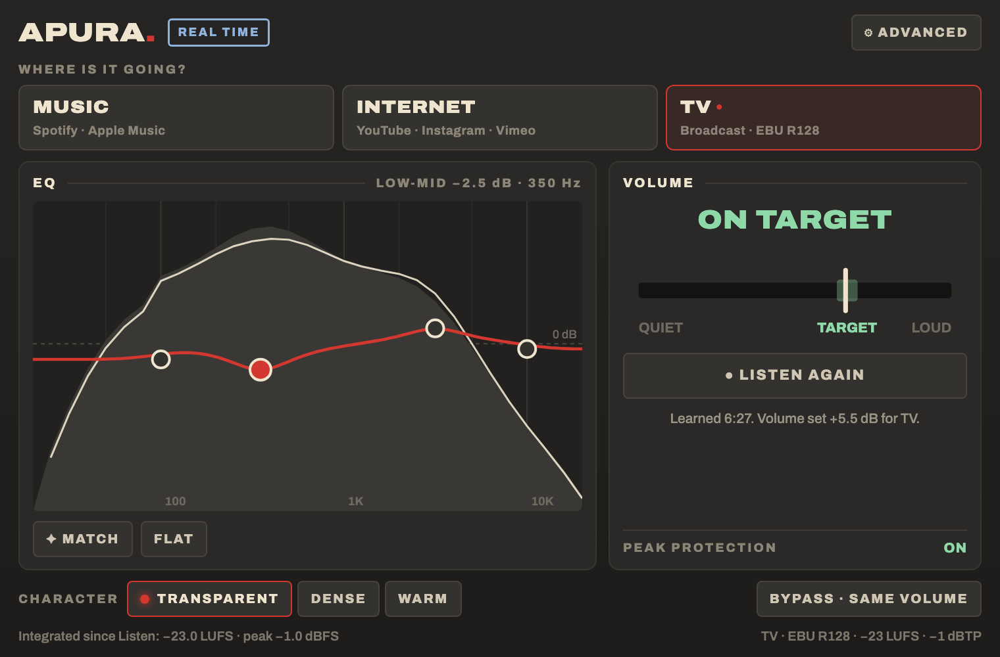

# Apura

Loudness e master para entrega, como plugin de áudio: **pendurado no master** do mixer, ao vivo,
ou no **AudioSuite** do Avid, no clip inteiro. Você diz para onde vai (música, internet ou TV),
aperta **LISTEN**, toca a sequência, e o Apura acerta o volume sozinho, com o pico protegido.
Software livre, feito por um editor de vídeo para o dia a dia de finalização.



## O que ele faz

- **Destino**: MUSIC (−14 LUFS), INTERNET (−16 LUFS) ou TV (EBU R128, −23 LUFS). No ⚙ ADVANCED dá para
  escolher qualquer alvo e o padrão americano ATSC (−24 LKFS, −2 dBTP).
- **LISTEN** (no master): o Apura ouve a sequência enquanto você toca e, quando você aperta de novo,
  acerta o ganho para o destino. Uma escuta basta: nos testes, a saída cai a ±0,05 LU do alvo.
  Trocar de destino depois do LISTEN ajusta o volume sem precisar ouvir de novo.
- **Clip inteiro** (AudioSuite do Media Composer e do Pro Tools): o Preview ou o Render mede o clip
  inteiro antes de processar e entrega no alvo. O clip novo ganha o sufixo do destino (TV23, WEB16…).
- **EQ de 4 pontos** que você arrasta direto no gráfico, sobre o espectro. **MATCH** coloca os pontos
  onde a análise sugere; **FLAT** zera.
- **Caráter**: TRANSPARENT (só ganho e limitador), DENSE (com compressor, mais denso, bom para celular)
  e WARM (saturação leve).
- **Proteção de pico**: limitador de pico verdadeiro (true peak, oversampling 4×), sempre ligado.
  O teto padrão é −1 dBTP.
- **BYPASS · SAME VOLUME**: o original no mesmo volume, para comparar de forma justa.

LUFS é a régua de volume que TV e internet usam: mede o quanto o som *parece* alto, não o pico.
A medição segue a norma ITU-R BS.1770-4 (os mesmos coeficientes; um seno de 997 Hz a 0 dBFS dá −3,01 LKFS).

## Instalar

Baixe na página de **[Releases](https://github.com/danilolemosx/apura-plugin/releases)**.

**Mac** (Apple Silicon e Intel, macOS 11 ou mais novo): o `.pkg` instala AAX, VST3 e AU.
Na primeira vez, o macOS avisa que não pode verificar o desenvolvedor (o Apura é gratuito e não é
registrado na Apple): clique em OK, abra **Ajustes do Sistema → Privacidade e Segurança**, role até o
aviso do instalador e clique em **Abrir Mesmo Assim**. O AAX vai assinado pela PACE, como exige a Avid.

**Windows** (10/11): descompacte o zip e copie a pasta **Apura.vst3** para
`C:\Program Files\Common Files\VST3\`. Por enquanto só VST3 no Windows (o AAX de Windows precisa
da assinatura PACE feita no Windows).

## Como usar

**Media Composer, no master (ao vivo)**
1. No Audio Mixer, ponha o Apura num insert do canal **Master**.
2. Escolha o destino e aperte **LISTEN**. Toque a sequência inteira (ou um bom trecho) e aperte de novo.
3. A palavra vira **ON TARGET**. O mixdown e o export já saem no volume certo.

**Media Composer / Pro Tools, no clip (AudioSuite)**
1. Selecione o trecho, abra o AudioSuite e escolha **Apura**. As faixas L e R vão juntas.
2. Escolha o destino e dê **Preview** (a janela mostra a análise) e **Render**.

**Premiere, Resolve, Logic**: o VST3 / AU funciona ao vivo no master (Mix do Premiere, Fairlight,
Stereo Out do Logic), do mesmo jeito: destino, LISTEN, toca, aperta de novo.

Dica: a EQ muda um pouco o volume. Se mexer nela (ou usar o MATCH) depois do LISTEN, faça outro LISTEN.

## Como nasceu

O Apura começou medindo o comportamento do Mastering Assistant do Logic Pro: sinais de teste passados
por ele e comparados na saída (EQ, loudness, compressão, saturação, estéreo), sem abrir nenhum código
da Apple. Daí veio um protótipo em Python, depois um motor em Rust idêntico ao protótipo, e por fim um
desenho próprio, pensado para entrega de vídeo: alvo de entrega, proteção de diálogo e nada que estrague
uma mix que já está boa. A medição e o protótipo estão em `referencia/`.

## Como é feito

- `motor/`: o motor em Rust (análise, EQ, dinâmica, loudness BS.1770, true peak 4×, o tempo real e o
  LISTEN). `cargo test --release` roda os testes: a cadeia ao vivo é igual à do clip inteiro amostra a
  amostra, e um LISTEN só chega no alvo nos três caracteres.
- `juce/`: o plugin, com JUCE 8.0.9 e um remendo (`juce/patches/`) que dá ao AAX um *Host Processor*:
  no AudioSuite o Avid entrega a seleção inteira, com todos os canais juntos, antes de processar.
  A janela é uma página HTML (`juce/ui/`), com a fonte Archivo.
- `referencia/`: a especificação medida, o protótipo em Python e os geradores dos sinais de teste e dos
  casos de referência (`motor/tests/paridade.rs` confere o motor contra o protótipo).
- `scripts/`: preparar o JUCE, gerar o áudio de teste do CI e montar o instalador do Mac.

### Compilar

Precisa de Rust, CMake e do JUCE 8.0.9 com o remendo (o script baixa e aplica):

```
scripts/preparar-juce.sh
cmake -B build -S juce -DCMAKE_BUILD_TYPE=Release
cmake --build build --config Release --target Apura_AAX Apura_VST3 Apura_AU testa-apura
```

Para o Mac universal (Apple e Intel), use `-DAPURA_UNIVERSAL=ON`. No Windows é preciso o WebView2;
veja `.github/workflows/plugin.yml`, que compila e testa Mac e Windows a cada envio.

`testa-apura` testa sem programa de edição: `testa-apura entrada.wav saida.wav destination=2` faz o que o
AudioSuite faz; `testa-apura --ao-vivo entrada.wav saida.wav destination=1 character=1` simula o master
com LISTEN.

O AAX só carrega no Avid com a assinatura da PACE. Quem compilar o próprio AAX precisa da sua própria
conta de assinatura (gratuita) junto à Avid e à PACE.

## Licença

O plugin é distribuído sob a **GNU AGPL-3.0** (veja `LICENSE`), uma exigência do JUCE para projetos
abertos. O motor (`motor/`) também pode ser usado sob MIT ou Apache-2.0.

Créditos: [JUCE](https://juce.com) (AGPL-3.0), [realfft](https://github.com/HEnquist/realfft) e
[rustfft](https://github.com/ejmahler/RustFFT) (MIT/Apache-2.0), fonte
[Archivo](https://github.com/Omnibus-Type/Archivo) (OFL).
